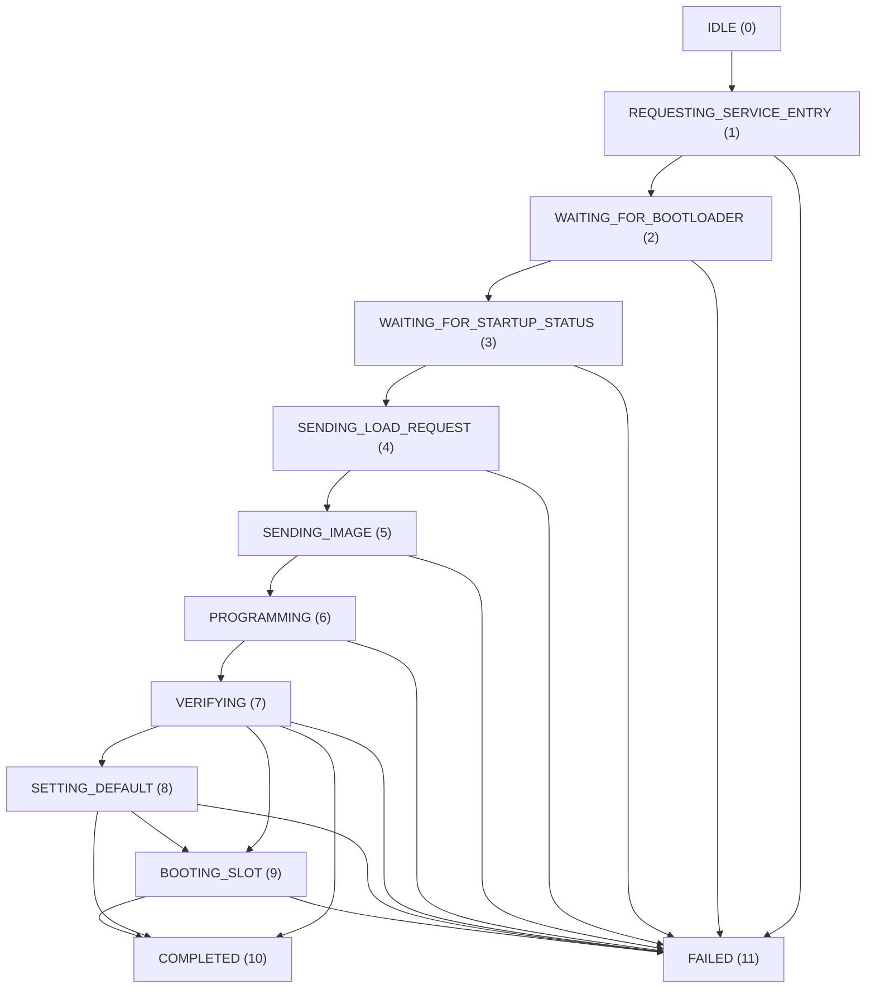

## Firmware Management

Bootloader-equipped instruments store runtime firmware in flash memory slots managed by an on-device service bootloader. The SDK provides a field-update workflow for loading images, managing slots and booting runtime firmware. Original Zynq without a bootloader uses direct runtime attachment and does not acquire these service features simply because it uses the same API.

> **UTT810 units without a bootloader.** Early UTT810 units were delivered without the bootloader. They keep working with this SDK and connect directly to their runtime. To receive firmware updates, such a unit needs a one-time bootloader installation by Nexatom service; contact Nexatom to arrange it. From then on, updates are loaded through the SDK or the app like on any other unit.

Ordinary measurement does not require this workflow: native `connect_runtime` can boot an already-valid image when needed. Use field update when you intend to change firmware. The SDK supplies the service tools and bundles the current firmware catalogue; catalogues are also published on their own (see [Firmware catalogues](#firmware-catalogues)).

<a id="firmware-catalogues"></a>

### [Firmware catalogues](1_4_firmware.md#firmware-catalogues)

Nexatom publishes firmware as numbered catalogues. Each catalogue is a GitHub release named `firmware-catalog-N` in the [nexatom-downloads repository](https://github.com/nexatom-research/nexatom-downloads/releases). A release holds the images, their `firmware_manifest.json`, a `SHA256SUMS.txt` file and a zip bundle of all of them. The pointer `https://downloads.nexatom.in/firmware/latest.json` names the current catalogue; the Nexatom app follows that pointer, reads the manifest and offers the images that match the connected instrument.

The SDK package carries the current catalogue in its `firmware/` folder (`firmware_manifest.json` plus the images it lists; catalogue 4 in this SDK: `Z080_005.bin`, `Z080_004.bin`, `K168_005.bin` and `K168_004.bin`). A catalogue published after the SDK can carry newer images; the app finds them through `latest.json`, and an SDK user can download the `firmware-catalog-N` release directly.

The current catalogue is **catalogue 4**:

| Image | Instrument | Status | Firmware version | Notes |
|---|---|---|---|---|
| `Z080_005.bin` | UTT810 (Zynq, 8 inputs) | current | `0x0104` | Current UTT810 runtime, device protocol ABI 1.1. Requires SDK 0.1.0-preview.22.43 or later. |
| `Z080_004.bin` | UTT810 (Zynq, 8 inputs) | superseded | `0x0102` | Earlier UTT810 runtime, device protocol ABI 1.1, kept for reference. |
| `K168_005.bin` | UTT160810 (Kintex, 16 inputs, 8 outputs) | current | `0x0005` | Current UTT160810 runtime, device protocol ABI 1.1, with Fast TIHI on the 125 MHz trigger and pulse outputs with a fixed output latency (see [Pulse outputs](../02_hardware/2_13_dtc_pulse_outputs.md)). Requires SDK 0.1.0-preview.22.43 or later. |
| `K168_004.bin` | UTT160810 (Kintex, 16 inputs, 8 outputs) | superseded | `0x0001` | Earlier UTT160810 runtime, device protocol ABI 1.1, kept for reference. |

Install the `current` image for your instrument. A superseded image stays in the catalogue so that its bytes and checksum remain available.

Image names follow the product: `Z080_nnn` for the UTT810 and `K168_nnn` for the UTT160810, where `nnn` is the build count. A higher number is a later build. A file name always means the same bytes in every catalogue; new bytes get a new number. The earlier `BOOT_001.bin` name is retired.

### [Firmware image format](1_4_firmware.md#firmware-image-format)

Firmware images use a strict filename convention:

```
<NAME>_<VERSION>.bin
```

| Component | Format | Constraints | Example |
|---|---|---|---|
| `<NAME>` | ASCII alphanumeric | Exactly 4 characters, `isalnum()` | `Z080` |
| `<VERSION>` | Decimal unsigned integer | 0–4294967295 (`uint32`) | `005` |
| Extension | `.bin` | Required | `.bin` |

**Valid example:** `Z080_005.bin` — name `Z080`, version `5`.

The image loader validates this convention before loading a file. The example's `image_metadata_from_filename()` function extracts and validates the name and version from the filename stem by splitting on the last underscore:

```python
name, version = path.stem.rsplit("_", 1)
# name must be exactly 4 ASCII alphanumeric characters
# version must be a decimal unsigned integer
```

Firmware images that do not match this convention are rejected with `ValueError` before any flash write is attempted.

### [Firmware manifest](1_4_firmware.md#firmware-manifest)

Each firmware catalogue carries a `firmware_manifest.json` with `schemaVersion` (currently 2), `catalogVersion` and an `images` array. The fields below explain that format. The SDK archives carry one catalogue in `firmware/firmware_manifest.json` beside its images; take an image, its size and its checksum from the same catalogue, whether that is the bundled one or a published `firmware-catalog-N` release.

| Field | Type | Description |
|---|---|---|
| `fileName` | string | Image filename in `<NAME>_<VERSION>.bin` format |
| `displayName` | string | Human-readable name |
| `description` | string | Purpose of the image |
| `model` | string | Target hardware model (`UTT810` or `UTT160810`) |
| `channel` | string | Firmware channel (`runtime`) |
| `status` | string | `current` for the image to install; `superseded` for an earlier build kept for reference |
| `requires` | object | `abi` (device protocol ABI the image reports) and `minSdk` (oldest SDK that supports it) |
| `fwVersion` | string | Firmware version the running image reports, as hex (for example `0x0104`) |
| `sizeBytes` | integer | Image size in bytes |
| `sha256` | string | SHA-256 hex digest for integrity verification |

Use the supplier's `sha256` field to verify file integrity before loading. Filename validation does not establish hardware compatibility or verify the supplier's checksum. A catalogue entry identifies the intended target; the filename's four-character application name is not a replacement for that target information.

For a delivery that includes this catalogue, the following Python check compares actual file bytes with its selected entry. It performs no device operation:

```python
import hashlib
import json
from pathlib import Path

directory = Path("firmware")
catalogue = json.loads((directory / "firmware_manifest.json").read_text())
entry = next(item for item in catalogue["images"] if item["fileName"] == "Z080_005.bin")
image = directory / entry["fileName"]  # Replace the illustrative name with your supplied image.
if image.stat().st_size != entry["sizeBytes"]:
    raise ValueError("Image size differs from its manifest")
with image.open("rb") as stream:
    actual = hashlib.file_digest(stream, "sha256").hexdigest()
if actual.lower() != entry["sha256"].lower():
    raise ValueError("Image checksum differs from its manifest")
print("Image bytes match the selected catalogue entry")
```

`hashlib.file_digest` requires Python 3.11 or later. On Python 3.10 use `hashlib.sha256(image.read_bytes()).hexdigest()` for an image small enough to read into memory. Select the supplier-approved image before performing either check.

### [Field update workflow](1_4_firmware.md#field-update-workflow)

A field update follows a multi-phase state machine managed by the native library. The `nexatom_tt_load_field_update_image()` function drives all phases synchronously and reports progress via an optional callback.

#### State machine



#### Phase definitions (`nexatom_field_update_phase_t`)

| Value | Constant | Description |
|---|---|---|
| 0 | `NEXATOM_FIELD_UPDATE_PHASE_IDLE` | No operation in progress |
| 1 | `NEXATOM_FIELD_UPDATE_PHASE_REQUESTING_SERVICE_ENTRY` | Sending runtime-to-bootloader handoff request |
| 2 | `NEXATOM_FIELD_UPDATE_PHASE_WAITING_FOR_BOOTLOADER` | Waiting for device to enter bootloader mode |
| 3 | `NEXATOM_FIELD_UPDATE_PHASE_WAITING_FOR_STARTUP_STATUS` | Native service discovery and initial status exchange |
| 4 | `NEXATOM_FIELD_UPDATE_PHASE_SENDING_LOAD_REQUEST` | Sending slot load request to bootloader |
| 5 | `NEXATOM_FIELD_UPDATE_PHASE_SENDING_IMAGE` | Streaming image bytes to device |
| 6 | `NEXATOM_FIELD_UPDATE_PHASE_PROGRAMMING` | Bootloader writing image to flash |
| 7 | `NEXATOM_FIELD_UPDATE_PHASE_VERIFYING` | Bootloader verifying written image |
| 8 | `NEXATOM_FIELD_UPDATE_PHASE_SETTING_DEFAULT` | Setting the loaded slot as default |
| 9 | `NEXATOM_FIELD_UPDATE_PHASE_BOOTING_SLOT` | Issuing boot command for the loaded slot |
| 10 | `NEXATOM_FIELD_UPDATE_PHASE_COMPLETED` | Operation completed successfully |
| 11 | `NEXATOM_FIELD_UPDATE_PHASE_FAILED` | Operation failed |

#### Progress callback

The progress callback is invoked synchronously during `nexatom_tt_load_field_update_image()`. The payload is passed by value:

```c
typedef void (*nexatom_field_update_progress_callback_t)(
    nexatom_field_update_progress_t progress,
    void* user_data
);
```

**`nexatom_field_update_progress_t` layout:**

| Field | Type | Description |
|---|---|---|
| `struct_size` | `uint32` | Size of this struct (version guard) |
| `phase` | `uint32` | Current `nexatom_field_update_phase_t` value |
| `percent` | `uint32` | Overall progress percentage (0–100) |
| `current_operation` | `uint32` | Bootloader operation code |
| `last_error` | `uint32` | Last error code from bootloader |
| `boot_reason` | `uint32` | Boot reason reported by bootloader |
| `bytes_sent` | `uint64` | Image bytes transmitted so far |
| `total_bytes` | `uint64` | Total image size in bytes |
| `slot_count` | `uint32` | Number of firmware slots reported |
| `default_slot` | `uint32` | Index of default slot |
| `slot_index` | `uint32` | Current target slot index |
| `slot_image_name_ascii32` | `uint32` | 4-byte ASCII image name (packed) |
| `slot_image_version` | `uint32` | Image version in target slot |
| `slot_state` | `uint32` | Current slot state |
| `slot_is_default` | `uint32` | Whether target slot is default |

### [Loading a firmware image](1_4_firmware.md#loading-a-firmware-image)

#### CLI reference (`field_update_e2e.py`)

```powershell
python python/examples/field_update_e2e.py `
    --home . `
    --image firmware/Z080_005.bin `
    --slot 1 `
    --i-understand-this-writes-firmware `
    --boot-after-load
```

This command illustrates the syntax; substitute the catalogue image for your instrument (`Z080_nnn.bin` for a UTT810, `K168_nnn.bin` for a UTT160810) and a slot reported by your device. The current images are in the SDK's `firmware/` folder, for example `firmware/Z080_005.bin`. Do not select slot 1 merely because it appears in the example.

| Flag | Default | Description |
|---|---|---|
| `--image` | (required) | Path to firmware image (`.bin`) |
| `--slot` | (required) | Target slot index |
| `--i-understand-this-writes-firmware` | Off | **Required safety gate** — script refuses to write without this |
| `--allow-valid-slot-overwrite` | Off | Allow overwriting a `VALID` or `PENDING` slot |
| `--allow-default-slot-overwrite` | Off | Allow overwriting the default slot |
| `--set-default-after-load` | Off | Mark loaded slot as default boot slot |
| `--boot-after-load` | Off | Boot the loaded slot after programming |
| `--runtime-proof-sec` | `10.0` | Post-boot CPS/telemetry validation duration (s) |
| `--skip-runtime-proof` | Off | Skip post-boot data validation |
| `--timeout-ms` | `5000` | Connect timeout (ms) |
| `--mode-timeout-sec` | `20.0` | Protocol mode transition timeout (s) |

#### Script workflow

```
 1. Validate image filename convention (NAME_VERSION.bin)
 2. Discover device and connect
 3. Check protocol mode:
    • RUNTIME → request_global_stop_all_modes()
                request_field_upgrade_service_entry()
                refresh_field_update_status() to complete native service discovery
    • BOOTLOADER → proceed directly
    • UNKNOWN → wait with timeout, abort if unresolved
 4. Refresh slot table: refresh_field_update_status()
 5. Validate target slot:
    • Reject VALID/PENDING without --allow-valid-slot-overwrite
    • Reject default slot without --allow-default-slot-overwrite
 6. Load image: load_field_update_image()
    • Progress callback prints phase/percent/bytes
 7. [Optional] Set as default: set_field_update_default_slot_with_status()
 8. [Optional] Boot slot: boot_field_update_slot()
 9. [Optional] Additional close/reopen check and CPS+telemetry proof in the service example
```

#### Request struct (`nexatom_field_update_request_t`)

```c
typedef struct nexatom_field_update_request_t {
    uint32_t    struct_size;                 /* sizeof(this struct) */
    uint32_t    slot_index;                  /* Target firmware slot */
    const char* image_path;                  /* Null-terminated image file path */
    uint32_t    startup_ack_response_code;   /* Deprecated, ignored */
    uint8_t     set_default_after_load;      /* 1 = mark as default after write */
    uint8_t     boot_after_load;             /* 1 = boot slot after write */
    uint8_t     _padding0[2];               /* Alignment padding */
    uint32_t    request_flags;               /* Bitmask (see below) */
    uint32_t    expected_firmware_version;   /* Boot expectation, by request_flags */
    uint32_t    expected_device_abi;         /* Boot expectation, by request_flags */
    uint8_t     reserved[4];                /* Reserved for future use */
} nexatom_field_update_request_t;
```

`request_flags` bits:

| Bit | Constant | Meaning |
|---|---|---|
| `0x1` | `NEXATOM_FIELD_UPDATE_REQUEST_HAS_STARTUP_ACK_CODE` | Deprecated; ignored on the load path |
| `0x2` | `NEXATOM_FIELD_UPDATE_REQUEST_HAS_EXPECTED_FIRMWARE_VERSION` | `expected_firmware_version` is given |
| `0x4` | `NEXATOM_FIELD_UPDATE_REQUEST_HAS_EXPECTED_DEVICE_ABI` | `expected_device_abi` is given |

Any other bit returns `NEXATOM_ERROR_INVALID_PARAMETER` before anything is written to the board.

<a id="boot-expectation-and-read-back"></a>

#### Boot expectation and read-back

When the load also boots the slot (`boot_after_load = 1`), you can state the firmware version and device ABI you expect the booted runtime to report. After the runtime is ready, the SDK compares each given value exactly with what the board reports in its first telemetry. If one does not match, the call returns `NEXATOM_ERROR_CONFIGURATION_FAILED`; the board stays connected and usable as booted, so you can decide what to do next. An expectation without `boot_after_load` returns `NEXATOM_ERROR_INVALID_PARAMETER` before any write.

Pass an optional `nexatom_field_update_boot_read_back_t` (Python: `NexatomFieldUpdateBootReadBack`) to see what the booted runtime reported. Set its `struct_size` first. It is filled on every return path, including refusals. Its `flags` say which fields are meaningful:

| Flag | Value | Meaning |
|---|---|---|
| `NEXATOM_FIELD_UPDATE_BOOT_READ_BACK_TELM_READ` | `0x01` | A telemetry frame arrived from the booted runtime. Clear after a boot: no runtime answered. |
| `..._DECODED` | `0x02` | The SDK decoded the telemetry; otherwise only `telemetry_version`, `sequence` and `raw_words` are given |
| `..._FIRMWARE_VERSION_MISMATCH` | `0x04` | `firmware_version` differs from the expectation |
| `..._DEVICE_ABI_MISMATCH` | `0x08` | `device_abi` differs from the expectation |
| `..._FIRMWARE_VERSION_VALID` | `0x10` | `firmware_version` holds a value |
| `..._DEVICE_ABI_VALID` | `0x20` | `device_abi` holds a value |
| `..._PRODUCT_MODEL_ID_VALID` | `0x40` | `product_model_id` holds a value |

Branch on these flags, not on the error message text. A field without its `VALID` bit never matches an expectation.

#### Python example

```python
def progress(p):
    print(f"Phase={p.phase} {p.percent}% {p.bytes_sent}/{p.total_bytes} bytes")

device.load_field_update_image(
    image_path="firmware/Z080_005.bin",
    slot_index=1,
    set_default_after_load=False,
    boot_after_load=False,
    request_flags=0,
    progress_callback=progress,
)

# Load, boot and check that the board now runs firmware 0x0104 (Z080_005):
from nexatomtt import NexatomFieldUpdateBootReadBack

read_back = NexatomFieldUpdateBootReadBack()
device.load_field_update_image(
    image_path="firmware/Z080_005.bin",
    slot_index=1,
    boot_after_load=True,
    expected_firmware_version=0x0104,
    expected_device_abi=0x00010001,
    read_back=read_back,
    progress_callback=progress,
)
```

In Python the expectation arguments set the matching `request_flags` bits for you.

#### C example

```c
void on_progress(nexatom_field_update_progress_t p, void* ctx) {
    (void)ctx;
    printf("Phase=%u %u%% %llu/%llu bytes\n",
           p.phase, p.percent,
           (unsigned long long)p.bytes_sent, (unsigned long long)p.total_bytes);
}

nexatom_field_update_request_t req = {0};
req.struct_size = sizeof(req);
req.slot_index = 1;
req.image_path = "firmware\\Z080_005.bin";
req.set_default_after_load = 0;
req.boot_after_load = 0;

nexatom_error_code_t rc = nexatom_tt_load_field_update_image(
    device, &req, on_progress, NULL, NULL);   /* last argument: optional read-back */
```

> **Note.** `nexatom_tt_load_field_update_image()` is **synchronous**. It blocks until the entire load/program/verify sequence completes or fails. The progress callback executes on the calling thread. Ensure the calling thread is not a UI or event loop thread.

Check the returned error code (or Python exception) after loading. A progress percentage of 100 is not a substitute for successful completion. The code fragments above assume you have already refreshed service status, selected the correct image and applied the overwrite checks shown in the full script.

### [Slot management](1_4_firmware.md#slot-management)

The UTT810 bootloader manages a table of firmware flash slots. Each slot can hold one firmware image.

#### Querying the slot table

```c
nexatom_field_update_status_t status = { .struct_size = sizeof(status) };
nexatom_field_update_slot_info_t slots[8];
size_t slot_count = 0;

nexatom_error_code_t rc = nexatom_tt_refresh_field_update_status(
    device, &status, slots, 8, &slot_count);
```

```python
status, slots = device.refresh_field_update_status()
for slot in slots:
    print(f"Slot {slot.slot_index}: state={slot.slot_state} "
          f"version={slot.image_version} default={slot.is_default}")
```

> **Note.** If the device is in runtime mode, stop acquisition and call `request_field_upgrade_service_entry()` first. Then call `refresh_field_update_status()` so native code can perform the service exchange and return the slot table. Polling only a cached protocol-mode getter does not initiate that exchange. A status refresh reports slot state; it does not prove every slot has just undergone a complete image-integrity scan.

#### Slot states

| Value | Constant | Description |
|---|---|---|
| 0 | `NEXATOM_FIELD_UPDATE_SLOT_STATE_EMPTY` | No image programmed |
| 1 | `NEXATOM_FIELD_UPDATE_SLOT_STATE_VALID` | Contains a verified, bootable image |
| 2 | `NEXATOM_FIELD_UPDATE_SLOT_STATE_PENDING` | Image write in progress or incomplete |
| 3 | `NEXATOM_FIELD_UPDATE_SLOT_STATE_CORRUPT` | Image failed verification |

Only a `VALID` slot is eligible for runtime boot selection. `PENDING` and `CORRUPT` slots indicate incomplete or invalid programming state. Native boot still has to establish a usable runtime after the device accepts the boot request.

#### Slot info struct (`nexatom_field_update_slot_info_t`)

| Field | Type | Description |
|---|---|---|
| `slot_index` | `uint32` | Slot position in the flash table |
| `image_name_ascii32` | `uint32` | 4-byte ASCII image name (packed, e.g. `0x424F4F54` = `BOOT`) |
| `image_version` | `uint32` | Image version number |
| `slot_state` | `uint32` | One of `EMPTY`, `VALID`, `PENDING`, `CORRUPT` |
| `is_default` | `uint32` | Non-zero if this is the default boot slot |

#### Status struct (`nexatom_field_update_status_t`)

| Field | Type | Description |
|---|---|---|
| `struct_size` | `uint32` | Size guard for versioned struct layout |
| `boot_reason` | `uint32` | Bootloader boot reason code |
| `slot_count` | `uint32` | Total number of firmware slots |
| `default_slot` | `uint32` | Index of the current default boot slot |
| `current_operation` | `uint32` | Active bootloader operation |
| `last_error` | `uint32` | Last bootloader error code |

#### Setting the default slot

```c
nexatom_tt_set_field_update_default_slot(device, slot_index);
```

Or atomically set default and refresh the slot table:

```c
nexatom_tt_set_field_update_default_slot_with_status(
    device, slot_index, &status, slots, 8, &slot_count);
```

The valid default slot has priority during automatic native runtime entry. Setting it changes persistent boot preference; a one-time `boot_field_update_slot()` call does not change that preference. Power-on service timing is handled by native discovery and the installed bootloader, so applications must not depend on a fixed boot-decision delay.

#### Booting a slot

```c
nexatom_field_update_boot_request_t boot = {0};
boot.struct_size = sizeof(boot);
boot.slot_index = slot_index;
/* Optional expectation: */
boot.request_flags = NEXATOM_FIELD_UPDATE_REQUEST_HAS_EXPECTED_FIRMWARE_VERSION;
boot.expected_firmware_version = 0x0104;

nexatom_field_update_boot_read_back_t read_back = {0};
read_back.struct_size = sizeof(read_back);

nexatom_error_code_t rc = nexatom_tt_boot_field_update_slot(device, &boot, &read_back);
```

```python
device.boot_field_update_slot(slot_index)
# or, with an expectation and read-back:
device.boot_field_update_slot(slot_index, expected_firmware_version=0x0104,
                              read_back=read_back)
```

The boot request accepts only the two expectation bits (`0x6`) in `request_flags`; any other bit, `HAS_STARTUP_ACK_CODE` included, returns `NEXATOM_ERROR_INVALID_PARAMETER` before any write. Expectations and the read-back work as described for the load call above. The call returns `NEXATOM_ERROR_DEVICE_BUSY` when made from an SDK callback.

The native boot operation retains the same handle and waits for runtime readiness. Applications do not need to wait for a USB disappearance, rediscover the board or create a replacement handle. A successful boot acknowledgement alone is insufficient; check the boot call's result and the resulting native profile before using measurement controls.

The advanced `field_update_e2e.py` and `runtime_bootloader_handoff.py` scripts additionally close and reopen a device after boot to exercise that lifecycle and, when requested, verify data. This is an extra diagnostic check in those examples, not the startup sequence required of every SDK client.

#### Automatic slot selection

The `select_runtime_slot()` function selects the best slot to boot using this precedence:

| Priority | Rule |
|---|---|
| 1 | `preferred_slot` if specified and `VALID` |
| 2 | Default slot if `VALID` |
| 3 | Lowest-index `VALID` slot |
| — | `RuntimeBootError` if no `VALID` slot exists |

```python
from nexatomtt import select_runtime_slot

slot_index = select_runtime_slot(status, slots, preferred_slot=None)
```

### [Safety precautions](1_4_firmware.md#safety-precautions)

> **CAUTION.** Firmware programming writes directly to on-device flash memory. Improper operation can render the device unbootable.

**During firmware programming:**
- **Do not** disconnect the USB cable.
- **Do not** remove power from the device.
- **Do not** terminate the host application.
- **Do not** close the device handle.

Do not interrupt the programming sequence (phases 5–7: `SENDING_IMAGE` → `PROGRAMMING` → `VERIFYING`). An interruption can leave the target slot unusable; refresh status after recovery rather than assuming a particular resulting slot state.

**Slot protection safeguards:**

The `field_update_e2e.py` script enforces three levels of protection:

| Safeguard | Flag required | Default |
|---|---|---|
| Any firmware write | `--i-understand-this-writes-firmware` | Refused |
| Overwrite a `VALID` or `PENDING` slot | `--allow-valid-slot-overwrite` | Refused |
| Overwrite the default boot slot | `--allow-default-slot-overwrite` | Refused |

**Recovery.** If service remains reachable, refresh the slot table and use the guarded load workflow to repair the intended slot. `PENDING` requires the valid-slot overwrite acknowledgement; overwriting a default slot requires its separate acknowledgement. Preserve a known-good image when possible. A remaining `VALID` entry is a recovery candidate, not a guarantee against every flash, service or image failure.

**Image source.** Load only firmware images supplied by Nexatom or explicitly approved for your hardware model. The `firmware_manifest.json` provides SHA-256 checksums for verification. Verify the checksum before loading:

```powershell
certutil -hashfile firmware\Z080_005.bin SHA256
```

Compare the output with the `sha256` field in `firmware_manifest.json`.
