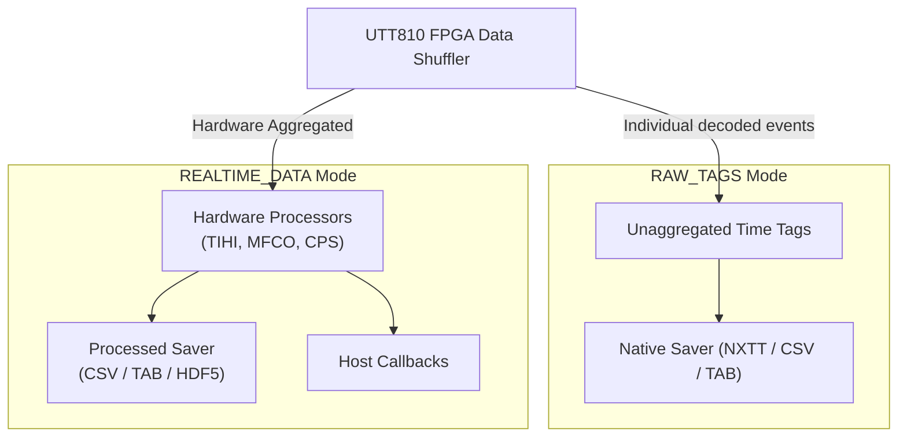
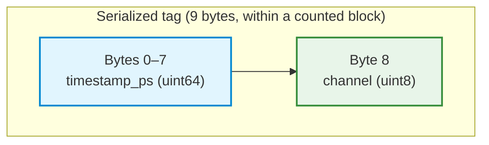

## File Saving and Data Export

The native file writer records data without sending each payload through Python or another client language. Choose the event or processed-data saver to match the selected hardware output mode. The diagram shows how native recording and application callbacks relate to those two workflows.



<a id="raw-time-tag-file-saving"></a>

### [Raw time-tag file saving (`RAW_TAGS` mode)](6_1_file_saving_and_data_export.md#raw-time-tag-file-saving)

`NEXATOM_OUTPUT_RAW_TAGS` selects individual event output. Configure engines and output while the system is quiet; selecting a saver does not itself stop existing engines or begin capture. Native decodes the wire stream and writes timestamp/channel records without routing each event through Python. Check the active profile for supported output modes, including encoded-tag output where available. Throughput depends on event rate, USB transport and host storage; binary saving does not guarantee lossless operation at every rate.

The native file saver is configured via the `nexatom_time_tag_file_config_t` struct and enabled via `nexatom_tt_enable_time_tag_file_saving()`.

Choose `NEXATOM_TT_FILE_BINARY` for compact `.nxtt` data, `NEXATOM_TT_FILE_CSV` for comma-separated text, or `NEXATOM_TT_FILE_TAB` for tab-separated text. **The text files contain individual time tags**, with the columns `Event time (ps)` (integer picoseconds) and `Input` (counted from 1: Input N is channel N-1). They are distinct from processed histogram/count packets. Preserve integer picoseconds when loading a file; converting a large timestamp immediately to a floating-point second value can lose fine differences. The layout of the text files is described under [Text file layout](#text-file-layout).

**File Rotation:**
To prevent single-file filesystem limits on long acquisitions, the native saver automatically rotates output files based on configured thresholds:
*   `max_file_size_mb`: File-size rotation threshold in MiB, counting the file's bytes on disk with its header; zero disables it. No file exceeds it: the SDK writes the whole tags that fit and continues in the next file, and never splits a tag. A limit smaller than the header plus one record is refused with `NEXATOM_ERROR_INVALID_PARAMETER`.
*   `max_duration_minutes`: Triggers rotation based on elapsed wall-clock time.
*   `max_event_count`: Triggers rotation after a specific number of time tags.
*   `rotate_on_acquisition_boundary`: Forces a new file when a `start/stop` condition is triggered.

**Naming Convention:**
The SDK automatically generates sequentially numbered files using the following pattern:
`<base_prefix>[_timestamp]_TAGS_<sequence>[_suffix].<ext>`

Sequences are four-digit and one-based. Native may create date subdirectories, so inspect the generated directory tree instead of assuming the base filename is a single literal output file. The rotation limits apply at once, also to a file that is already open when the configuration is set during a save. The files of a series together hold exactly the tags written, in order.

<a id="processed-data-file-saving"></a>

### [Processed data file saving (`REALTIME_DATA` mode)](6_1_file_saving_and_data_export.md#processed-data-file-saving)

When the device output type is set to `NEXATOM_OUTPUT_REALTIME_DATA`, the native saver can persist the aggregated payload packets (CPS, TIHI, MFCO, CORM, CORL, TELM) to disk concurrently with callback dispatch.

This is enabled via `nexatom_tt_enable_processed_file_saving()` using `nexatom_processed_file_config_t`. Supported export formats include:
*   **HDF5:** The recommended binary format for complex hierarchical structures (like Multi-Tau correlation matrices and TIHI fit results).
*   **CSV / Tab-Separated:** Best for simple visual inspection of CPS and telemetry data.

Set options with `set_processed_file_config(packet_type, config)`, enable each required sink with `enable_processed_file_saving(packet_type, base_filename, format)`, then explicitly start the acquisition. Enabling time-tag saving disables processed saves, and enabling processed saving disables tag saves. Processed CSV/TAB and HDF5 cannot be mixed within one active saver configuration. HDF5 uses a session container rather than the per-packet text-file rotation limits.

Processed text timestamps use Unix epoch milliseconds. CPS channel values are already rates in Hz. TIHI contains bins and histogram settings; MFCO contains 256 pattern bins and its configuration/quality metadata; CORL/CORM contain lag/value pairs and normalization information. Keep that metadata with the numerical arrays.

Processed CSV and TAB files of one packet family carry the same `#` lines, heading row and values; only the delimiter differs. Standard CSV readers read them after skipping the `#` lines (see [Text file layout](#text-file-layout)).

**Files from earlier SDKs:** preview.8 CORL and CORM CSV files contain unescaped JSON delimiters, so strict CSV readers reject those rows. Read them with their TAB or HDF5 counterparts. Do not repair a scientific record by silently dropping or splitting metadata. This never affected the individual time-tag CSV format.

Different packet families have different columns. Skip every line that starts with `#` before using a CSV reader; do not parse with `line.split(',')`. The MFCO pattern columns are headed `None`, `Input 1`, `Inputs 1+2` and so on. Files written by earlier SDKs have a longer header (`# NexatomTT <family>, <CSV|TAB>, <schema> | ...`, a third line `# Check: ...`), no closing line, CPS headings `Ch_0` ... and the time-tag heading `Event time (ps),Channel` with the 0-based channel. Their versioned MFCO CSV files include a quoted `metadata_json` field and the declared pattern count, and their TAB files can include JSON metadata: read the schema marker before interpreting columns, and parse the outer delimiters before decoding JSON.

For HDF5, inspect root `schema_version` and each dataset's columns, units and description attributes. Current files use root schema version 4 (`nexatomtt_pd_hdf5_v4`), one dataset per measurement type with the CSV headings as member names. HDF5 tables count inputs from 0 (`Ch_0` ... `Ch_7` in the `cps` table; `No slot`, `Slot 0`, `Slots 0+1` ... in the MFCO table), while the text files count them from 1. TIHI, CORL and CORM rows in HDF5 do not record their inputs: after an input change during a save, only the text files tell the input pairs apart. MFCO from schema version 3 onward includes result-quality metadata; an older file without those fields has unknown quality, not zero errors. Specialized Fast TIHI index products require their own capability and schema; a `.csv` extension does not make their layout identical to CPS or TIHI.

<a id="text-file-layout"></a>

### Text file layout

Every CSV and TAB file that the SDK writes live with its header on (count rates, time histograms, coincidence patterns, both correlators, device status, time tags and the Fast TIHI files) has the same short layout: three `#` lines, the heading row, the rows, and one closing `#` line.

```text
# Count rates · 2026-10-01 13:05
# Counting interval (ms): length of the counting interval | Input 1 to Input 8: counts/s on that input | Total: counts/s of all inputs
# Count and check in the last line
Counting interval (ms),Input 1,Input 2,Input 3,Input 4,Input 5,Input 6,Input 7,Input 8,Total
100,10,0,0,0,0,0,0,0,10
# 1 counting interval, confirmed; ended: stopped by user
```

- **Line 1** says what the file is and when it was opened (local time, to the minute): `Count rates`, `Time histograms`, `Coincidence pattern counts`, `Correlation g2, linear`, `Correlation g2, multi-tau`, `Device status`, `Time tags`, `Fast TIHI click records` or `Saving integrity records`. TIHI, CORL and CORM files also name the inputs every row has (`· trigger Input 1 · detector Input 2`, `· Inputs 1 × 3`). When the inputs change during a save, the file ends with `; continues in the next file` and the next file names the new inputs, so no row is lost or written twice. The batch counted partly under the old inputs is in no file, as it is in no live result.
- **Line 2** says what each column means.
- **Line 3** is always `# Count and check in the last line`.
- **The closing line**, written when the file closes, counts the rows (`N counting intervals`, `N histograms`, `N curves`, `N reports`, `N tags on Inputs 1, 3`, `N clicks on Input 2 in M measurements`, `N records`) and then says either `; continues in the next file` (a rotation closed it) or how the saving ended:
  - `, confirmed; ended at the set count`, `at the set time`, `with the measurement`, `: stopped by user`, `: disconnected`, `: board time restarted`, `: input rate too high`, `: saving settings changed` or `: the measurement type changed` for a normal end;
  - `, saving stopped: <reason>` when a loss or a fault ended the saving (for example `the reference clock was lost` or `a settings change failed`);
  - `, saving not confirmed: data blocks are missing` (Fast TIHI files also `window check failed`), or `, saving not confirmed: no saving record` when no recording end is known.

A text file keeps 2,048 bytes of its size limit free for the closing line. Inputs are counted from 1 in the text files, as the application numbers them: Input N is the 0-based channel N-1. The `.nxtt` and `.nxti` files, the C API and Python keep the 0-based channel. To read a file, skip every line that starts with `#`.

A time-tag export ([Time-tag export](6_2_offline_time_tag_binary_decoder.md#time-tag-export)) writes a similar first and second line, puts the count and the check on line 3 and has no closing line.

<a id="ending-a-recording"></a>

### Ending a recording and checking it

A **recording** starts when the first file saving is enabled while none is, and ends when the last one closes. One recording can therefore span several savers and several rotated files.

**How a recording ends.** Disabling the saving is the user's stop. Disable a time-tag saving while the output is still `RAW_TAGS`: the files then close with `confirmed; ended: stopped by user`. Switching the output type during a recording ends it at the switch (`the measurement type changed`, also a normal end); switching the output on from `NO_OUTPUT` never ends a recording. A disconnect ends it as `disconnected`. The SDK also ends a recording by itself when the set save end is reached, or when a loss or fault means the saved span could not stay whole; it then disables the recording's file saving itself, and the measurement goes on.

A data file path is never opened over an existing file: if the path exists, the sequence number advances.

#### Save end

`set_save_end(kind, value=0)` (C: `nexatom_tt_set_save_end()`) ends each recording by itself:

| `kind` | Ends the recording |
|---|---|
| `NEXATOM_RUN_END_NONE` | When the saving is disabled (`value` is ignored) |
| `NEXATOM_RUN_END_TIME` | After `value` ms of board time, counted from the first tag written. A raw file keeps exactly the tags with a time below the first tag's time + `value` × 10⁹ ps |
| `NEXATOM_RUN_END_COUNT` | After `value` raw tags (Fast TIHI clicks when the recording saves Fast TIHI clicks). A raw file keeps exactly `value` tags |

Set it before enabling saving; it applies to every later recording until changed. It is independent of `set_run_end()`: it only closes the recording and never stops or changes the measurement. Tags after the cut are discarded and are not counted as dropped. The call returns `NEXATOM_ERROR_INVALID_PARAMETER` for an unknown kind or for `TIME`/`COUNT` with value 0, and `NEXATOM_ERROR_DEVICE_BUSY` while any file saving is enabled. For a recording that saves Fast TIHI clicks, the save end works in whole 1 s windows: `COUNT` closes at the first complete window where the clicks reach `value` (never fewer), `TIME` when complete windows × 1000 ms reach `value`.

#### File-saving statistics

`get_file_saving_statistics()` (C: `nexatom_tt_get_file_saving_statistics()`, 200-byte record, version 2) reads the file stage's own counters. It never touches the device and can be polled while saving. The counters are cumulative for the handle, so take a snapshot before enabling saving and compare differences.

- **Was everything written?** After `disable_time_tag_file_saving()` returns, the file stage kept everything it was given when `raw_tags_received == raw_tags_written`, `buffers_dropped == 0` and `write_errors == 0` (Python: `statistics.complete`). `raw_tags_received` counts the tags from the recording's start to the stop's cut.
- **`span_complete`** says in one word that the last recording's saved span is whole: 1 after every normal end (set count, set time, measurement end, stop, and a disconnect whose end was recorded), 0 only on a real defect, and 0 while a recording runs and before the first one ends. After a save end it stays 1, although the tags after the cut make `raw_tags_received` exceed `raw_tags_written`.
- **Progress.** `raw_save_end_target` and `raw_save_end_done` (Fast TIHI: `tidx_save_end_target`, `tidx_save_end_done`) give the progress toward the save end; the target is 0 for `NONE`. `raw_first_board_time_ps` and `raw_last_board_time_ps` give board times of the saved tags.
- Other fields: `buffers_received`, `buffers_processed`, `raw_tags_enqueued`, `bytes_written` (bytes put on disk, headers included), `files_created`, `rotation_count`, `file_saving_enabled`, and the Fast TIHI counters `tidx_records_written`, `tidx_chunks_written`, `tidx_windows_complete`, `tidx_window_mismatches`, `tidx_chunk_gaps`, `tidx_duplicate_chunks`.

#### Saving result

`get_saving_result()` (C: `nexatom_tt_get_saving_result()`, 264-byte record, version 3) holds the result of the current or last recording. It never touches the device, also works after disconnect, and stays readable until the next recording starts. While the recording runs, `end_reason` is `RUNNING`. Once saving reads as off (`file_saving_enabled` 0), one call returns the final result. If several ends meet, the first one is kept.

| Field | Meaning |
|---|---|
| `end_reason` | Why the recording ended (table below) |
| `flags` | `NEXATOM_TT_SAVING_RESULT_SPAN_COMPLETE` (no loss inside the saved span), `_BOARD_CHECK_UNAVAILABLE`, `_CLOSE_PROBLEM`, `_CLOSE_PENDING` (the files are still closing; a new enable returns `NEXATOM_ERROR_FILE_IN_USE` until it clears) |
| `save_end_kind`, `save_end_value` | The save end that was set |
| `raw_tags_written`, `tidx_records_written` | What the recording's files hold after the cut |
| `end_host_utc_ns` | Computer time when the last kept tag, window or row was saved; 0 when nothing was written |
| `end_board_time_ps`, `end_board_time_kind` | Board time of the end: `NEXATOM_TT_BOARD_TIME_EXACT` (raw: the last tag written), `_NOMINAL` (Fast TIHI: complete windows × 1000 ms) or `_NONE` |
| `saved_kinds` | `NEXATOM_TT_SAVING_RESULT_SAVED_RAW`, `_TIDX`, `_PROCESSED` |
| `windows_complete`, `windows_discarded_at_end`, `last_complete_run_id`, `bytes_truncated`, `files_removed` | Fast TIHI clicks: the file ends at its last complete window; these describe that cut |
| `detail` | A short plain reason a user can read (for example `permission denied`, `the disk is full`); never a path or an error code. The log has the full text |
| `incident_id` | Not 0 when the end was the SDK's or the board's fault: the id of the `INCIDENT <id>` block in the log |
| `file_problem` | For a file error: `NEXATOM_TT_FILE_PROBLEM_NONE` 0, `_DISK_FULL` 1, `_ACCESS_DENIED` 2, `_PATH_GONE` 3, `_WRITE_FAILED` 4, `_CLOSE_PENDING` 5, `_FINALIZE_FAILED` 6 |

End reasons (`NEXATOM_TT_SAVE_END_REASON_*`):

| Reason | Value | Meaning |
|---|---|---|
| `RUNNING` | 0 | The recording is still running, or none has run yet |
| `USER_STOP` | 1 | Stop, or the saving was disabled |
| `DISCONNECTED` | 2 | The board was disconnected |
| `TIME_END` | 3 | The save end (`TIME`) was reached |
| `COUNT_END` | 4 | The save end (`COUNT`) was reached |
| `INSTRUMENT_BUFFER_FULL` | 5 | The board's buffer was full: the computer could not keep up |
| `HOST_STALLED` | 6 | The computer could not keep up; the SDK ended the recording at the last written data before its buffers ran out |
| `FILE_IO_ERROR` | 7 | A file could not be written or created; the save ends at once and `detail` says why (`permission denied`, `the disk is full`, `the folder was removed`, `the drive is not available`, `the file could not be written`) |
| `TRANSPORT_ERROR` | 8 | Disconnected after USB transport errors during the recording |
| `BOARD_DATA_LOSS` | 9 | The board dropped time tags during the recording; `get_board_loss()` says where and why |
| `PIPELINE_ERROR` | 10 | The SDK could not finish the file correctly |
| `RUN_END` | 11 | The Fast TIHI run end came first (Fast TIHI click recordings) |
| `TIME_BASE_RESET` | 12 | The board time restarted during a time-tag recording; the file ends at the last tag before the restart |
| `FAST_TIHI_PAIR_DROP` | 13 | A Fast TIHI context got trigger + detector events faster than it can take, and the board stopped that window; the file ends at the last complete window before it |
| `SAVE_SETTINGS_CHANGED` | 14 | The saving settings changed during a Fast TIHI click save; that recording ended and saving went on in a new one |
| `PIPELINE_ABORTED` | 15 | A settings change (an output-type switch) failed during the recording; the files close with what was written |
| `OUTPUT_TYPE_CHANGED` | 16 | The output type changed during the recording; a normal end at the switch |
| `REFERENCE_LOST` | 17 | The external reference clock was lost during the recording; the recording ends at the loss |
| `BOARD_RESTARTED` | 18 | The board was rebooted or reconfigured during the recording |
| `CORRELATOR_PACKET_DROP` | 19 | The computer did not keep up and the board dropped correlator data (UTT810 images that report it) |

`span_complete` is set after the normal ends (`USER_STOP`, a recorded `DISCONNECTED`, `TIME_END`, `COUNT_END`, `RUN_END`, `OUTPUT_TYPE_CHANGED`) and also after `FAST_TIHI_PAIR_DROP` and `PIPELINE_ABORTED`, whose saved span is whole. It is always clear after `BOARD_DATA_LOSS`, `REFERENCE_LOST`, `BOARD_RESTARTED` and `CORRELATOR_PACKET_DROP`. For `TIME_BASE_RESET` it depends on the board: on the UTT810 before firmware `0x0103` a calibration restarts the board time, the tags before the restart are whole and `span_complete` stays set; on the UTT160810, and on the UTT810 from firmware `0x0103`, the board time runs on across output types (on the UTT810 also across calibrations and peripheral resets), so a restart inside a recording means the board's runtime restarted, data just before it can be missing, and `span_complete` is clear.

`get_last_incident()` (C: `nexatom_tt_get_last_incident()`, 168-byte record) returns the last incident raised for the handle: `incident_id` (0 until the first), `host_utc_ns`, `reason`, `sub_reason`, `flags` and `summary`. The log lines that start with `INCIDENT <incident_id> ` hold its context; keep them with a support request.

`get_board_loss()` (C: `nexatom_tt_get_board_loss()`, 48-byte record) describes a board loss that ended the current or last recording. It never touches the device and works after disconnect. `flags` has `NEXATOM_TT_BOARD_LOSS_VALID` only when the recording ended as `BOARD_DATA_LOSS` at a board loss; then `cause` (`NEXATOM_TT_BOARD_LOSS_CAUSE_INPUT_TOO_FAST` 1: an input is faster than the board can take; `_LINK_TOO_SLOW` 2: the USB link or the computer cannot carry the rate; `_FAULT` 3: a firmware fault in the data path), `input_mask`, `input` and, when the loss came from the raw-stream marker (`NEXATOM_TT_BOARD_LOSS_FROM_MARKER`), `loss_time_ps` (board time of the first dropped tag) and `loss_id` say where and why.

<a id="keeping-up-with-the-data"></a>

### Keeping up with the data

While a recording saves, the SDK holds its processing pipeline instead of dropping data. When the computer cannot keep up, it ends the recording with `HOST_STALLED` at the last written data, before its buffers run out.

**Before the start**, `check_start_rate(expected_input_rate_hz, planned_file_saving_mask=0)` (C: `nexatom_tt_check_start_rate()`, 144-byte record) checks whether the expected input rate can pass the USB link. Call it after setting the output type and before starting; it may run before file saving is enabled. Raw time tags count 4 bytes per event; with `NEXATOM_TT_START_CHECK_PLAN_FAST_TIHI_INDEX` in the planned mask, Fast TIHI click records count 8 bytes per event. `blocked` is 1 only when the rate needs more than the link can ever carry (USB 2: 53,248,000 B/s; USB 3: 400,000,000 B/s); `reason` explains the figure in plain text. `blocked = 0` is not a promise that the recording keeps up. Encoded tags and other output are not checked, an unknown link speed never blocks, and free disk space is the caller's check. For Fast TIHI, keep each context's input rate below the profile's `fast_tihi_max_input_rate_hz[c]`.

**While it runs**, `get_data_flow_status()` (C: `nexatom_tt_get_data_flow_status()`, 56-byte record) shows how the host keeps up. It never touches the device; the figures change every 100 ms.

| Field | Meaning |
|---|---|
| `state` | `NEXATOM_TT_DATA_FLOW_OK` (0): the computer keeps up, or no recording saves; `_WARN` (1): the backlog is above a quarter of the host buffer, or has risen for 3 s and would reach the limit within 10 s, or the decoder or USB reader falls behind the USB input; `_STALLED` (2): the recording ended with `HOST_STALLED` |
| `slowest_stage` | `NEXATOM_TT_STAGE_NONE`, `_USB` (the link carries about as much as it can), `_READER`, `_DECODER`, `_PROCESSING`, `_FILE_INTAKE`, `_WRITER` |
| `backlog_bytes`, `backlog_limit_bytes` | What all host queues hold, against the whole host buffer |
| `input_bytes_per_s` | Bytes read from the USB link over the last second |
| `output_bytes_per_s` | Memory the file writer took over the last second (decoded data, not disk bytes); compare it with itself over time, not with the input |
| `usb_blocked_ms`, `backlog_rising_ms` | How long the USB read engine has waited for room; how long the backlog has kept rising |

All figures are zero, with state `OK`, while no recording saves. A `WARN` gives the application time to tell the user: at the FT601's top rate, a writer that stops warns about 1.7 s before the recording ends.

**Board time.** `get_board_time_upper_bound()` (C: `nexatom_tt_get_board_time_upper_bound()`) returns an upper bound of the board time now, in ps on the time base of a raw time-tag save started after the call. It sends nothing and never waits. It needs the processed output type with periodic telemetry on (`enable_telemetry(True)`) and two telemetry packets, about 2 s after either; otherwise it returns `NEXATOM_ERROR_NOT_AVAILABLE`. The figure is at most 4.5 s of board time above the board time now, or one wire period (2⁵⁹ ps) more when a wire boundary lies between the last telemetry and the first tag of the save.

### [NXTT binary file format](6_1_file_saving_and_data_export.md#nxtt-binary-file-format)

The `.nxtt` file is an uncompressed binary container for decoded time tags. It is not a dump of the USB wire framing and does not serialize the padded C/Python structures with `sizeof`.

**1. Serialized file header — 16 bytes**
Every `.nxtt` file begins with a standardized metadata header:
*   `magic` (4 bytes): ASCII `NXTT`, without a terminating NUL on disk.
*   `created_timestamp_us` (`uint64_t`): A 64-bit unsigned integer representing microseconds since the UNIX epoch.
*   type word (`uint32_t`): bits 15:0 hold the output data type (`2` raw tags, `1` encoded tags; matches `nexatom_output_data_type_t`), bits 31:16 the file format version: 0 in format 1 (the word is exactly 1 or 2) and 2 in format 2 (`0x00020002` or `0x00020001`). Refuse any other value.

> **Host structures and disk bytes differ.** The native reader returns an aligned `nexatom_time_tag_file_header_t` with a NUL-terminated magic field and padding for ABI access. Those extra bytes are not in the file. Integers on disk are little-endian. Prefer the supplied reader instead of reimplementing this codec.

**2. Data Payload (Record Layout)**
The header is followed by blocks. Each block begins with a little-endian `uint32` count, followed by that many packed tags. Each tag occupies **9 bytes**: an eight-byte timestamp and one-byte channel. A block count is framing, not a time tag.



*   **`timestamp_ps`**: Decoded hardware timestamp in picoseconds; not a Unix timestamp or a promise of a new zero origin for every host acquisition.
*   **`channel`**: Decoded event channel identifier. Interpret it using the active image/profile's channel mapping.
*   **Host padding:** The C/Python `NexatomTimeTag` representation is aligned and has padding. This padding is absent from the nine-byte on-disk tag.

Events are in recorded order, not sorted by time or channel. The writer never writes an empty block (skip one if you meet it).

**3. End record (format 2)**
The SDK saves every binary time-tag file as format 2. A closed format 2 file ends with 80 bytes: the sentinel `0xFFFFFFFF` in the place of a block count, then a 76-byte end record (`TTND`) that says how the file ended:

| Offset | Size | Field |
|---|---|---|
| 0 | 4 | `TTND` (ASCII, no NUL) |
| 4 | 4 | `record_bytes`, always 76 |
| 8 | 4 | `end_reason`: `0xFFFFFFFF` = the recording continues in the next file; otherwise the recording's save end reason; 0 when no end is known |
| 12 | 4 | `flags`: bit 0 = span complete, set only in the end record that ends the recording |
| 16 | 8 | `recording_id`: creation time (µs) of the recording's first file, the same in every file of the recording |
| 24 | 4 | `file_sequence`: this file's place in the recording, from 1 |
| 28 | 8 | `tags_in_file` |
| 36 | 8 | `inputs_in_file`: bit n set when the file holds a tag of channel n |
| 44 | 8 | `first_tag_ps`; 0 in a file without tags |
| 52 | 8 | `last_tag_ps`; 0 in a file without tags |
| 60 | 8 | `end_host_utc_ns`: when the file was closed (computer clock, information only) |
| 68 | 4 | reserved, 0 |
| 72 | 4 | CRC-32 (IEEE 802.3 / zlib, Python `zlib.crc32`) of bytes 0–71 of the record |

A file is closed when its last 80 bytes are the sentinel and a `TTND` with `record_bytes` 76 and a valid CRC; its blocks then run from byte 16 exactly to the sentinel, and anything else is damage (the reader returns `NEXATOM_ERROR_FILE_IO`). A file without a valid end record (a crash, power loss, or a file still being written) may end anywhere: read every whole 9-byte record up to the torn end and stop at a block count of `0xFFFFFFFF`. Take a file's place in a recording from `file_sequence`, not from the `_NNNN` of its name. Format 1 files, written by earlier SDKs, have no end record and read as before.

The complete description of both binary formats (`.nxtt` and the Fast TIHI `.nxti`), for reading files without the SDK, is in the package's `docs/C_API_DEVELOPER_GUIDE.md` (section "Binary file formats").

### Finalizing and reviewing a capture

Follow the complete [raw-capture tutorial](../03_tutorials/3_4_raw_time_tag_capture_and_offline_csv_export.md) or processed template: stop/observe the intended measurement, finalize the active savers while the output is still on, read the file-saving statistics and the saving result, then quiet system output and check disconnect errors (see [Ending a recording and checking it](#ending-a-recording)). `flush_immediately` requests file-manager flushing; it is not an acquisition-completion or durable-storage guarantee.

After cleanup, enumerate the files actually created, verify their headers and read at least one record from each requested packet family. A saver with no received data may not create a file immediately. Preserve any parsing failure alongside the original file instead of marking the capture successful merely because files are nonempty.
